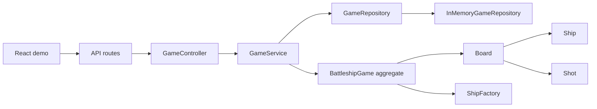
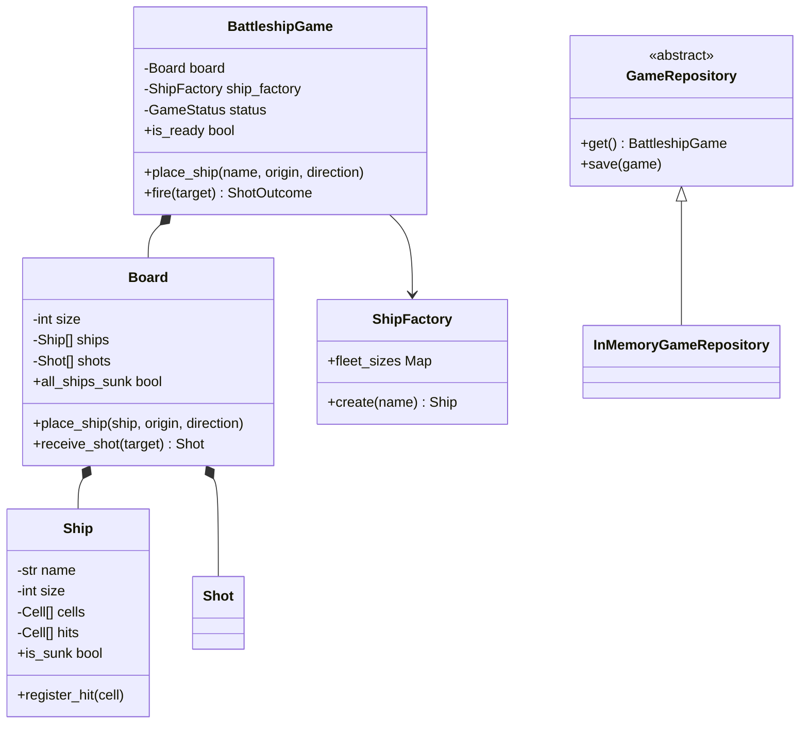
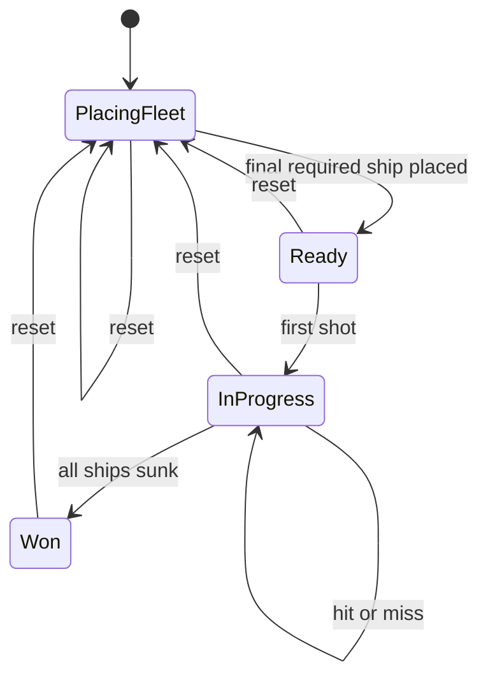
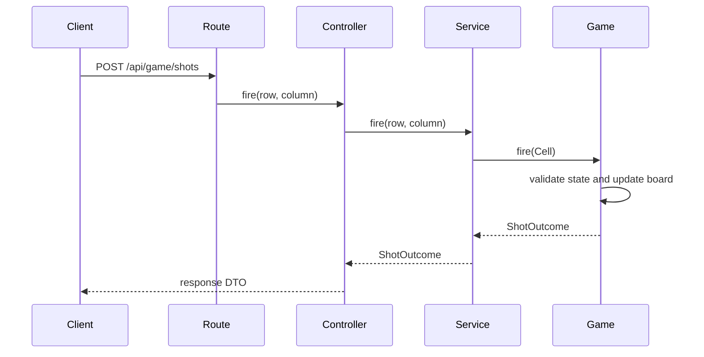

# Battleship Low-Level Design

This is the implementation design for the scoped 90-minute solution. The
separate [design decisions](DESIGN_DECISIONS.md) document explains alternatives
and trade-offs; [production readiness](PRODUCTION_READINESS.md) describes the
next architecture.

## 1. Architecture

Dependencies move toward the application and domain abstractions. Domain models
do not import FastAPI, Pydantic, controllers, or repositories.

## 2. Package responsibilities

| Package | Responsibility |
|---|---|
| `models` | Game state and invariants: board, ships, cells, shots, status transitions. |
| `exceptions` | Named domain failures; no HTTP knowledge. |
| `factories` | Constructs supported ship types from the fleet configuration. |
| `repositories` | Abstracts where the current game is stored. |
| `services` | Implements application use cases and coordinates repository access. |
| `controllers` | Converts domain objects into the public JSON representation. |
| `api` | HTTP schemas, routes, and exception-to-status mapping. |
| `main.py` | Composition root; creates and wires concrete dependencies. |

## 3. Domain model

## 4. State transitions

The aggregate enforces these invariants:

- A configured ship is placed at most once.
- Every occupied cell is inside the board.
- Ships never overlap.
- Firing starts only after the complete fleet is placed.
- A cell is targeted at most once.
- Placement stops after the first valid shot.
- No command mutates a won game except reset, which creates a new aggregate.
- Failed commands leave the existing game state unchanged.

## 5. Request sequence

## 6. Patterns used

- **Aggregate Root:** `BattleshipGame` is the only public coordinator for state transitions.
- **Repository:** `GameRepository` isolates storage; `InMemoryGameRepository` is the machine-coding adapter.
- **Factory:** `ShipFactory` centralizes valid ship types and their sizes.
- **Service Layer:** `GameService` exposes application use cases without transport logic.
- **Controller:** `GameController` maps model objects to the external response shape.
- **Composition Root:** `main.py` owns dependency construction; classes do not instantiate their own infrastructure dependencies.

## 7. Decisions and trade-offs

1. The `Board` owns placement and hit detection because those rules require knowledge of all cells and ships.
2. `Ship` owns its hit set and sunk calculation; the service does not inspect or mutate internal collections.
3. Collections are exposed as tuples or frozen sets to prevent accidental mutation.
4. `BattleshipGame` uses a re-entrant lock so placement, firing, and state transitions are atomic in this in-memory implementation.
5. Domain exceptions remain independent of HTTP. The API adapter maps malformed commands to `400` and state conflicts to `409`.
6. The sample models one game. Supporting many games requires a `game_id` repository key, not changes to `Board`, `Ship`, or shooting rules.

Detailed rationale, rejected alternatives, and the SOLID mapping are in
[DESIGN_DECISIONS.md](DESIGN_DECISIONS.md).

## 8. Deliberately out of scope

- Two-player turn orchestration
- Random/computer fleet placement
- Authentication and multiple concurrent game IDs
- Persistence and event history
- WebSocket updates

These are extension points, not missing responsibilities in the scoped aggregate.

## 9. Complexity

Let `S` be the number of ships and `L` the size of the ship being placed.

| Operation | Time | Space added |
|---|---:|---:|
| Place ship | `O(S × average_ship_size + L)` | `O(L)` |
| Fire | `O(S × average_ship_size)` | `O(1)` |
| Check win | `O(S)` | `O(1)` |

For an 8×8 board and three ships, the simple scans are easier to verify than a
second occupancy index. If fleet size becomes large, `Board` can maintain a
`Cell -> Ship` index for constant-time hit lookup.

## 10. Production evolution

For a networked, multi-game implementation:

1. key the repository by `game_id` and add optimistic versioning;
2. authenticate players and authorize actions against game membership;
3. persist commands or domain events for replay and audit;
4. make commands idempotent so client retries do not duplicate shots;
5. use compare-and-swap on the game version to prevent concurrent turns;
6. publish committed events through an outbox before WebSocket fan-out;
7. expose metrics for invalid commands, conflicts, latency, and active games.

The aggregate remains the consistency boundary. A distributed lock is not a substitute for a durable version check at the storage boundary.
